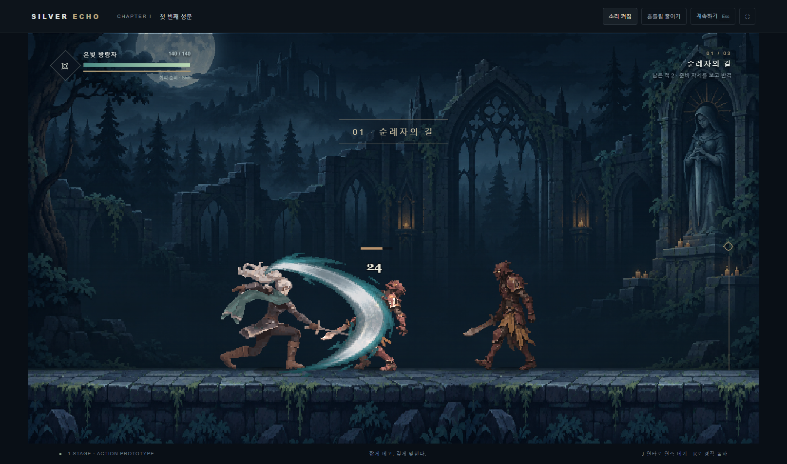

# 2026-11-10 성과와 기술 인수인계

## 주장: 실행 가능한 액션 1스테이지

은발 검사가 세 전투 구간을 지나 수문장을 쓰러뜨리는 웹 게임을 만들었다. 병사 6명과 수문장 1명, 탈출, 사망, 재시작을 연결했다. GPT로 배경·적·핵심 자세·이펙트를 제작했고 기존 걷기·베기 프레임을 게임 안에서 재사용했다.

사용자는 큰 베기 이펙트, 연타 연결, 달리기를 본 뒤 “오 좋다”라고 평가하고 성과 정리와 GitHub 푸시를 요청했다. 이는 이번 결과에 대한 긍정 평가이며, 전체 아트 검사 통과나 출시 승인을 뜻하지 않는다.



### 다른 PC에서 실행

저장소 루트에서 실행한다. 게임 재생에는 GPU·ComfyUI·외부 API·Node 패키지 설치가 필요 없다. Python 3는 정적 파일 서버로만 쓴다.

```powershell
python3 -m http.server 8201 --bind 127.0.0.1 --directory samples/silver-stage-01
```

브라우저에서 `http://127.0.0.1:8201/`을 연다. A/D 또는 방향키로 이동한다. 같은 방향을 두 번 누르고 유지하면 달린다. J는 연속 베기, K는 강공격, Shift는 회피, Space는 점프, Esc는 일시 정지다.

## 구현 기술

### 원화와 움직임을 분리

배경, 병사 8자세, 수문장 8자세, 주인공 보조 자세 6장, FX 8프레임을 GPT 이미지로 만들었다. 기존 걷기 26장과 베기 25장까지 합쳐 런타임 아틀라스에는 81프레임을 넣었다. 캐릭터는 사용자가 선호한 B 방향의 Sprite Forge hi-bit 후처리를 적용했다. 도구 기준 커밋은 `6b3da5c444363378e20f3fce130ebecc22f343dd`다.

새 유료 영상 생성은 사용하지 않았다. GPT 이미지 생성과 모든 제작 비용이 무료였다는 뜻은 아니다. 적은 핵심 자세에 시간·이동·회전을 적용해 움직인다. 달리기도 기존 걷기를 빠르게 재생한 임시 표현이다.

원본 이미지와 실행용 아틀라스는 샘플의 `assets/`에 보존했다. [`manifest.json`](../../samples/silver-stage-01/assets/manifest.json)에 출처, 프레임 수, 피벗, 해시, 후처리 검사 결과가 있다. `build/` 중간 파일과 로컬 모델·도구 설치본은 전달하지 않는다. `prepare-assets.py`로 다시 제작하려면 이 PC의 외부 입력과 도구가 별도로 필요하다.

### 타격감은 재생 시간과 명중 반응으로 구성

전투 규칙은 [`game.mjs`](../../samples/silver-stage-01/game.mjs), 화면·입력·소리는 [`main.mjs`](../../samples/silver-stage-01/main.mjs)로 나눴다. 화면 없이도 전투를 검사할 수 있다. 전투 수치는 `config.json`, 연출 수치는 `feel.json`이 맡는다.

| 항목 | 적용 내용 |
|---|---|
| 명중 | 피해·피격 자세·밀림·명중 정지·소리를 같은 사건에서 처리한다 |
| 명중 정지 | 약한 타격부터 50/67/83ms. 빗나가면 적용하지 않는다 |
| 연타 | 공격 중 다음 한 동작을 예약한다. 입력이 쌓여 장시간 자동 공격하지 않는다 |
| 연결 | 첫째·둘째 타는 260ms, 셋째 타는 350ms부터 다음 동작으로 전환한다 |
| 되베기 | 기존 프레임의 순서를 바꿔 둘째 타로 연결한다 |
| 큰 궤적 | 가로·세로 1.50~1.73배. 피해와 판정 거리는 유지한다 |
| 달리기 | 이동키 두 번 누르기. 걷기 280px/s, 달리기 455px/s |
| 피격 | 공격 취소, 경직, 밀림, 잠깐의 무적을 적용한다 |
| 적 공격 | 준비 자세와 지면 표시를 먼저 보여 준다 |

## 증거

기준 커밋은 `4686d81b9b8b4790582931b0df639a8e8f9cf2e4`이며, 아래 자료는 그 이후 작업의 원시 출력이다.

- [최신 검사 명령·종료 코드](../../samples/silver-stage-01/qa/v2/results.json), [전투 15/15](../../samples/silver-stage-01/qa/v2/combat.txt).
- [브라우저 연타·명중](../../samples/silver-stage-01/qa/v2/browser.txt), [오른쪽 달리기](../../samples/silver-stage-01/qa/v2/sprint-right.txt), [왼쪽 달리기](../../samples/silver-stage-01/qa/v2/sprint-diagnostic.txt).
- [연출 상수 충족](../../samples/silver-stage-01/qa/v2/feel.txt), [플러그인 검사](../../samples/silver-stage-01/qa/v2/plugin.txt).
- 최초 버전의 [브라우저 전체 진행](../../samples/silver-stage-01/qa/browser-playthrough.txt)에서 입력만으로 7명 처치와 탈출을 확인했다. 최신 전투 테스트에도 전체 진행 검사가 있다. 이를 사람 승률이나 재미 점수로 해석하지 않는다.
- [최초 제작 보고](../../samples/silver-stage-01/REPORT.md), [연타·달리기 수정 보고](../../samples/silver-stage-01/REVISION-2.md).

재검사 명령:

```powershell
node --test samples/silver-stage-01/game.test.mjs
node skills/polish/scripts/feel-audit.mjs samples/silver-stage-01/feel.json
node scripts/validate-plugin.mjs
```

`python3 samples/silver-stage-01/qa-revision.py`는 Pillow가 설치된 환경에서 추가 FX 대조 검사까지 실행한다. 원시 로그를 새로 쓰므로 이전 결과를 보존한 뒤 실행한다. 초기 `run-qa.mjs`의 일부 아트 검사는 Git에서 제외한 `build/`를 요구한다.

## 기준과 공백

타격마다 같은 적에게 한 번만 피해를 주고, 연타 예약이 명중 정지 중에도 유지되어야 한다. 달리기는 키 반복 입력으로 시작하지 않아야 한다. 이 조건은 자동 검사에 포함했다.

기존 베기 형태 검사는 여전히 미달이다. 달리기 전용 원화도 없다. 큰 FX의 [플래시 대조](../../samples/silver-stage-01/qa/v2/flash.txt)는 **조건부**이며, 최대 변화 영역 2.7%, 실효 8회/초를 보고했다. 실제 전투 녹화의 안전 판정을 대신하지 않는다. 모바일 실기기·게임패드·여러 기기의 성능 검수는 아직이다.

검수 보드의 최신 카드는 `demo.silver-stage01@2`다. `.review-loop/`의 이전 연구 카드 일부는 로컬 `out/`를 가리킨다. 해당 카드의 모든 실험 폴더를 이번 푸시에 포함하는 것은 아니며, 웹 스테이지 실행에 필요한 파일은 샘플 안에 있다.

## 잔여 위험과 다음 작업

큰 궤적의 장식은 판정 거리 밖으로 뻗는다. 연타가 빨라져 난도가 내려갈 수 있다. 사람 플레이로 가독성과 손맛을 더 확인한다. 기존 베기 자세와 달리기 원화는 별도로 개선한다.

사용자가 보낸 영상에 따른 [Unity Particle System 활용 검토](../art/unity-particle-vfx-research-2026-11-10.md)를 함께 남겼다. GPT 텍스처를 Unity 프리팹으로 조립하는 방향이며, Unity 제작기와 실제 엔진 검증은 아직 구현하지 않았다.
