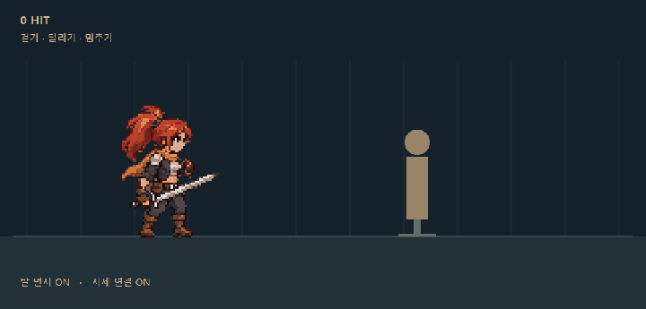
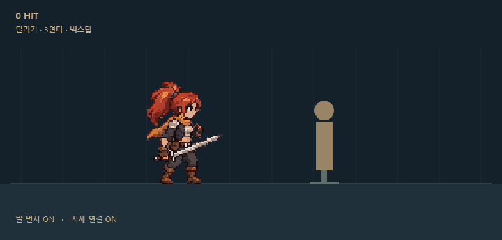

# 2026-11-13 인수인계: 은발 v8와 적발 모션 리소스

## 주장: 지금 이어서 볼 결과

최신 작업은 **적발 3등신의 이동·공격 연결과 발 먼지**다. 아래 HTML은 이미지를 포함하므로 저장소를 받은 뒤 브라우저에서 바로 열 수 있다. GitHub 파일 화면에서는 HTML이 실행되지 않는다.

| 결과 | 재생 화면 | 리소스 |
|---|---|---|
| 은발 베기 v8 | [preview.html](../../out/experiments/silver-impact-20261113/preview.html) | [PNG 8장](../../out/experiments/silver-impact-20261113/frames-v8), [GIF](../../out/experiments/silver-impact-20261113/impact-v8.gif) |
| 적발 2·3·5등신 | [index.html](../../out/experiments/red-mercenary-20261113/index.html) | [기본 PNG](../../out/experiments/red-mercenary-20261113/pixel), [대기 v2](../../out/experiments/red-mercenary-20261113/pixel-idle-v2), [GIF](../../out/experiments/red-mercenary-20261113/gifs) |
| 적발 3등신 연속·스킬 공격 | [index.html](../../out/experiments/red-combat-3h-20261113/index.html) | [PNG 48장](../../out/experiments/red-combat-3h-20261113/pixel), [GIF](../../out/experiments/red-combat-3h-20261113/gifs) |
| 적발 3등신 동작 연결·먼지 | [index.html](../../out/experiments/red-flow-3h-20261113/index.html) | [PNG 76장](../../out/experiments/red-flow-3h-20261113/pixel), [GIF](../../out/experiments/red-flow-3h-20261113/gifs) |

원본 시트는 각 폴더의 `raw/`에 있다. 보존된 프롬프트, 제작·재생 스크립트와 설정도 함께 올렸다. [전체 파일 목록](../art/2d-resources-2026-11-13.json)에 크기와 SHA-256을 남겼다. 중복 재생 캡처, 대용량 캡처 JSON, 임시 정규화 비교본은 제외했다. 원본 생성·PixelOE 재실행에는 별도 도구 설치와 환경 경로 설정이 필요하다.

### 이번에 바뀐 점

- 은발 v8은 4번 자세의 팔·검 연결을 고쳤다. 나머지 7장은 v7과 같다.
- 적발 여성 용병을 2·3·5등신으로 만들었다. 각 비율에 대기·걷기·달리기·베기·피격을 넣고 큰 베기 이펙트를 붙였다.
- 대기는 마지막에 주저앉아 보인다는 피드백을 받아 서 있는 자세로 바꿨다. 사용자가 수정본을 긍정 평가했다.
- 적발 3등신에 3연타, 돌진, 회전 공격을 추가했다. 빠른 입력은 다음 공격으로 예약한다.
- 이동 연결본은 수동 공격·스킬 입력 때 위치를 초기화하지 않는다. 이동 위상을 유지하고 발 디딤·검 내리기 자세를 거쳐 연결한다. 백스텝도 추가했다.
- 걷기·달리기·급정지·백스텝 착지에 먼지를 넣었다. 먼지는 밟은 바닥에 남는다. 가려 보인다는 피드백 뒤 캐릭터 다음에 그리도록 바꾸고 진행 방향 뒤로 퍼뜨렸다.

연결본 조작은 A/D 또는 방향키 이동, Shift 달리기, J 연타, Q/E 스킬, Space 백스텝, R 초기화다. 먼지·자세 연결·베기 이펙트를 각각 끄고 비교할 수 있다. 자동 시연만 주기 끝에서 시작 위치로 돌아간다.

## 증거: 실행 기록

검사 당시 기준 커밋은 `cdd14a658c801bfa3d07a2492c3a2ecb4adbb6b0`이다. 리소스의 실제 바이트는 파일 목록과 각 manifest의 해시로 구분한다.

| 범위 | 확인 결과 | 원시 기록 |
|---|---|---|
| 동작 연결 | 로직 13/13 충족, 기존 대기·공격 48장 불변 | [최종 검증 JSON](../../out/experiments/red-flow-3h-20261113/qa/verification-final.json), [로직 출력](../../out/experiments/red-flow-3h-20261113/qa/model.stdout.log) |
| 새 백스텝·검 내리기 | 정합성 2/2 충족, 도트 계약 2/2 미달 | [백스텝 정합성](../../out/experiments/red-flow-3h-20261113/qa/evade-sprite.stdout.log), [검 내리기 정합성](../../out/experiments/red-flow-3h-20261113/qa/guard-sprite.stdout.log), [백스텝 도트](../../out/experiments/red-flow-3h-20261113/qa/evade-pixel.stdout.log), [검 내리기 도트](../../out/experiments/red-flow-3h-20261113/qa/guard-pixel.stdout.log) |
| 연결본 화면 | 플래시 7개 시퀀스 exit 0, 브라우저 오류 0건, 390px 화면 확인 | [플래시 기록](../../out/experiments/red-flow-3h-20261113/qa/flash-results.json), [브라우저 기록](../../out/experiments/red-flow-3h-20261113/qa/browser-results.json) |
| 먼지 가림 수정 | 동일한 928ms 장면에서 캐릭터 위로 보이는 먼지 픽셀 0개에서 51개 | [전후 측정](../../out/experiments/red-flow-3h-20261113/qa/browser-results.json) |
| 앞선 결과 | 은발·비율 비교·공격의 검사 결과와 남은 미달을 각각 보존 | [은발 보고서](../../out/experiments/silver-impact-20261113/REPORT.md), [비율 보고서](../../out/experiments/red-mercenary-20261113/REPORT.md), [공격 보고서](../../out/experiments/red-combat-3h-20261113/REPORT.md) |

프로젝트 공통 art-gate는 기존 샘플 누락으로 exit 3이다. [시작 검사 원문](../../out/flow-20261113-baseline/art-gate-report.md)을 보존했다. 측정 불가를 이번 에셋의 실패나 통과로 바꾸지 않는다.

저장소 루트에서 재생 코드와 검사를 실행한다. `verify.mjs`는 도구별 종료 코드를 JSON에 기록한다. 프로세스 종료만 보고 전체 통과로 해석하지 않는다.

```powershell
node out/experiments/red-flow-3h-20261113/test.mjs
node out/experiments/red-flow-3h-20261113/verify.mjs
node out/experiments/red-flow-3h-20261113/build.mjs
```

## 기준: 유지할 규칙과 사용자 선택

GPT 원화와 시트 공통 팔레트를 유지한다. 재생 속도와 함께 자세·검 궤적·발 접지를 본다. 캐릭터를 겹쳐 투명하게 섞는 전환은 사용하지 않았다. 먼지는 자세 오류를 고치는 근거로 쓰지 않는다.

사용자는 적발 대기 수정본에 “어 딱좋은디”, 공격 모음에 “우앙 많이 좋아졌네”라고 평가했다. 이어 모션 연결의 끊김과 먼지 가림을 수정 요청했다. 마지막 먼지 레이어 수정본은 최종 검수 대기다. 피드백과 승인 상태는 `.review-loop/`에서 관리한다.

## 공백: 아직 하지 않은 일

실제 스테이지나 Unity에는 반영하지 않았다. 현재 적중은 지정한 시점과 거리로 확인하는 시연이다. 검 충돌, 회피 무적, 상태 전환의 엔진 어댑터는 구현하지 않았다. 이번 푸시는 검토용 리소스 공유이며 프로덕션 승인으로 바꾸지 않는다.

## 잔여 위험과 다음 작업

새 두 클립은 외톨이 픽셀 비율이 도트 계약 상한을 넘는다. 기존 공격의 형태·도트 미달도 남아 있다. 자동 검사 충족과 자연스러운 모션을 구분한다. 연결은 준비된 자세를 골라 이어 주므로 모든 임의 전환을 새로 그린 것은 아니다.

다음 세션은 연결본을 직접 조작해 발 접지, 공격 후 이동, 연타 후 백스텝을 확인한다. 사용자가 고칠 장면을 정하면 해당 전환만 수정한다. 이후 엔진용 상태·입력 예약·취소 가능 시점을 옮긴다. 공용 스킬은 자동 변경하지 않는다.

### 최종 비교용 GIF

걷기·달리기·정지와 수정한 발 먼지:



달리기에서 3연타와 백스텝으로 연결:


