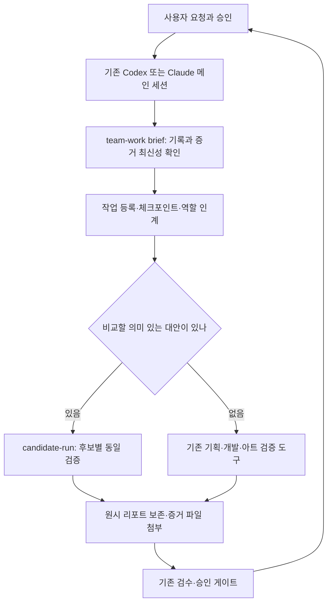

# Hermes·Harness² 구조가 데브팀에서 동작하는 방식

문서 기준: v0.50.0 소스. 대상은 기존 Codex·Claude Code를 사용하는 GameDevTeam이다. 이 문서는 설치된 캐시의 갱신이나 원본 제품 두 개의 동시 실행을 주장하지 않는다.

## 무엇을 가져왔나

| 참고한 구조 | 데브팀에 적용한 부분 | 가져오지 않은 부분 |
|---|---|---|
| Hermes | 세션 간 작업 재개, 역할 인계, 경험 기록 | Hermes 본체, 자체 모델 실행, 메신저, 예약 실행, 자동 스킬 수정 |
| Google Research Harness² | 대안 제안 → 같은 조건의 비교 실행 → 결과에 근거한 채택 제안 | 원본 실행기·벤치마크·모델 호출·무인 재귀 개선 |
| 기존 GameDevTeam | 기획·개발·아트 도구와 사람 승인 게이트 | 승인 권한을 새 원장으로 이전하지 않음 |

방법을 참고한 독립 구현이다. 원본 소스나 의존성을 복사해 실행하는 것이 아니다. 별도 모델/API를 호출하는 기능은 이번 연결 코드에 없다. 일반 Codex/Claude 사용 비용이나 사용자가 별도로 실행하는 생성 API 비용까지 없어진다는 뜻은 아니다.

## 실행 주체와 흐름

이 도구들은 사용자가 요청하거나 메인 세션이 절차에 따라 실행할 때만 동작한다. 백그라운드에서 두 에이전트가 독립적으로 결정을 내리는 구조가 아니다. 역할 인계는 기록상의 담당 역할과 다음 행동을 바꾸며 실제 에이전트를 실행하지 않는다. 후보 소스와 비교 지침도 메인 세션이 준비한다.

## 파일별 담당 범위

| 기록 | 담당 도구/주체 | 다른 기능이 할 수 있는 일 |
|---|---|---|
| `.team-work/state.json` | `team-work` | 작업·다음 행동·역할·증거·교훈 제안 관리 |
| `out/experiments/<id>/` | `candidate-run` | 비교 로그·판정·채택 제안 보존; team-work에는 파일 증거로 첨부 |
| `docs/pipeline/state.json`, `PIPELINE_STATE.md` | 기존 파이프라인 운영과 사람 승인 절차 | 새 수집기는 읽고 표시; 작업 done으로 게이트를 닫지 않음 |
| `.review-loop/` | 기존 검수 루프와 사람 | 승인·수정 피드백·공통 규칙을 읽음; 새 도구가 승인하지 않음 |
| `skills/`, `AGENTS.md`, `CLAUDE.md` 등 | 승인된 플러그인 소스 변경 절차 | 실험은 별도 사본 사용; 공용 파일을 후보 실행 폴더로 사용하지 않음 |
| 생성 제공자 작업 원장 | 기존 생성 파이프라인 | 기존 작업 ID 조회·대조; 새 도구는 제출·재전송하지 않음 |

담당 범위의 정적 정의는 `team-boundaries.mjs`에 있다. 이 정의는 정본 기록을 다른 원장에 복제하거나 자동 동기화하지 않는다.

## 작업 재개와 세션 충돌 방지

`team-work brief --project <프로젝트>`는 로컬 원장과 파이프라인/검수 파일을 읽어 JSON으로 모은다. 다음 행동·담당 역할·막힌 이유·최근 이벤트와 증거 파일의 현재 SHA-256을 표시한다. 상태 파일이 없거나 손상되면 unknown이다. unknown을 승인 대기 없음으로 바꾸지 않는다.

작업 기록 변경에는 두 장치가 있다:

1. 쓰기 잠금: 기록 교체 도중 다른 작성자가 동시에 쓰지 못한다. 오래된 잠금도 자동 탈취하지 않는다.
2. revision 확인: 세션이 읽었던 원장의 revision과 현재 값이 다르면 변경을 거부한다. 같은 codex 배우 이름을 쓰는 두 세션도 이 검사를 받는다. 최신 번호만 자동 재주입해 재시도하지 말고 바뀐 지시부터 읽는다.

revision은 논리적 낡은 쓰기 방지이며 사용자/세션 신원 인증이 아니다. 작업 원장을 직접 편집하는 외부 프로그램까지 통제하지 못한다. 배우 종류는 codex/claude-code/human 세 가지다. 사용법과 옵션은 [작업 재개·인계](team-work.md)에 있다.

## 후보 비교와 실험 격리

`candidate-run`은 planning/development의 artifact/workflow 비교를 지원한다. 기준안 1개와 대안 1~2개를 고정된 입력·평가 파일·조건으로 실행하고 원시 stdout/stderr·해시·0/1/3 결과를 남긴다. 아트 후보 생성 자체는 이 실행기의 구현 범위가 아니다. 아트는 기존 제작·검수 도구와 별도 비교 절차를 사용한다.

후보 cwd가 실제 `.team-work`, `.review-loop`, `.hermes`, `.agents`, `.claude`, `.codex`, `skills`, `docs/pipeline` 또는 주요 정본 파일과 겹치면 계약 검사에서 거부한다. 정본을 포함하는 상위 디렉터리도 후보로 삼을 수 없다. 별도 `candidates/A` 같은 사본에는 실험용 스킬/메모리를 둘 수 있다.

같은 실험의 후보 cwd끼리도 동일하거나 상하위로 겹칠 수 없다. 서로 다른 후보 ID를 붙여 같은 작업 폴더를 비교하는 상황을 막는다.

계약·입력·평가 도구·경계 모듈의 해시가 바뀌면 이전 실행의 resume을 거부한다. 따라서 이 버전으로 도구를 바꾼 뒤 기존 실행을 계속 붙이지 말고, 새 실행을 만들거나 이전 도구 버전에서 해당 실험을 마무리한다. retrySafe는 기존 실행기의 제한된 로컬 검사 재개 계약이며 유료 요청 재시도 권한이 아니다.

검증 명령은 신뢰하는 코드만 실행한다. cwd와 출력 경로 검사는 파일 시스템 샌드박스가 아니다. 검증 스크립트가 임의로 상위 파일을 수정하는 행위까지 OS 수준에서 막지 않으므로 기존 실행 권한·작업 공간 제한을 유지한다.

프로세스 트리 종료가 거부되면 실행기는 측정 불가·cleanupRequired를 기록하고 다음 후보와 자동 resume을 중단한다. 잠금을 유지하며 실제 정리를 사람이 확인한 뒤 새 실행으로 시작한다. Windows 정상 종료 뒤 남겨진 독립 백그라운드 프로세스의 완전한 정리까지 검증한 것은 아니다. 검증 명령은 전경에서 끝나는 작업으로 구성한다.

## 경험이 공통 규칙이 되는 지점

- 작업 교훈: `team-work lesson`이 작업 원장에 proposed로 저장한다.
- 실험 교훈: `candidate-run record`가 실행 폴더에 `decision.json`과 `lesson-proposal.json`을 proposed로 저장한다.
- 공통 규칙: 사람이 기존 review-loop에서 승격한 `.review-loop/rules.json` 기록을 재사용한다. 실험에서 사용하는 accepted 교훈은 기존 계약상 승인 파일의 해시도 요구한다.

이 제안들을 자동으로 서로 복사하거나 공용 스킬에 반영하는 기능은 없다. 승인자 이름이나 파일 존재만으로 실제 사람 신원을 자동 인증하지도 않는다. 일반 도구 개선은 검토 후 별도 소스 변경으로 진행한다.

## 판정과 승인

`candidate-run`의 0/1/3은 충족/미달/측정 불가다. `team-work`의 0은 기록·수집 완료일 뿐 평가 통과가 아니다. 첨부 파일 same은 바이트가 같다는 뜻이며 테스트 통과가 아니다. done은 담당 작업 완료 기록이며 사람 승인·merge·출시 승인이 아니다.

기획의 재미·완결성, 개발 정확성, 아트의 눈 검수는 기존 도구와 사람에게 남는다. 새 구조가 모션 품질이나 UI 완성도를 자동 보장하지 않는다.

## 자동화하지 않는 것과 검증 공백

새 모델 호출, 유료 생성 제출/재제출, 예약 실행, 에이전트 자동 증식, 자동 채택·승인·push, 공용 스킬 자동 변경은 없다. 도구별 잠금은 프로젝트 전체 파일 소유권을 강제하는 단일 잠금이 아니다. 정본 파일의 실제 수정 권한은 기존 ORCHESTRATION 계약을 따른다.

원본 Hermes와 Harness²를 실제로 설치해 함께 돌리는 호환 검증은 하지 않았다. 두 프로그램을 도입하려면 각각의 프로필·작업 사본·원장을 분리하고 이 문서의 승인/경계 규칙을 별도로 지켜야 한다. 설치 캐시는 소스 수정만으로 갱신되지 않으며 공식 install 스크립트로 갱신한다.

## 출처와 관련 자료

- [Hermes 메모리](https://hermes-agent.nousresearch.com/docs/user-guide/features/memory), [스킬](https://hermes-agent.nousresearch.com/docs/user-guide/features/skills)
- [Harness² 원본](https://github.com/google-research/harness2), [실험 안내](https://github.com/google-research/harness2/blob/main/docs/EXPERIMENTS.md)
- [후보 비교 계약](../skills/balance-sim/references/candidate-harness.md), [기존 조율 규칙](../ORCHESTRATION.md)
- [Hermes 선택적 연결 조사](hermes-integration.md): 원본 도입을 검토할 때의 참고 자료
